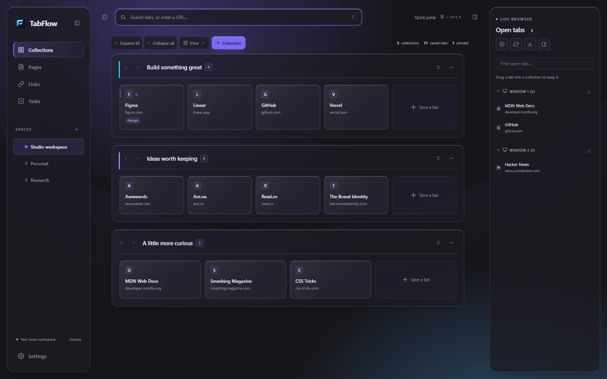

<p align="center"></p>

# TabFlow 2.0

**A workspace for everything your browser has open—and everything you want to keep.**

Turn your new tab into a place to return to a project, capture a browsing session, read a saved document, and decide what comes next. TabFlow brings saved tabs, live tabs, HTML Pages, aliases, and Tasks together in a workspace that lives in your browser profile.

Built for **Chrome, Edge, Firefox, and Zen**. No account. No application server. No frontend framework or build step.

[Get started](docs/installation.md) · [User guide](docs/user-guide.md) · [Troubleshooting](docs/troubleshooting.md) · [Developer architecture](docs/architecture.md)

**Download the current build:** [Chrome / Edge](https://github.com/Playcape/tabflow-extension_edge/raw/refs/heads/main/downloads/tabflow-2.0.0-chrome-edge.zip) · [Firefox / Zen](https://github.com/Playcape/tabflow-extension_edge/raw/refs/heads/main/downloads/tabflow-2.0.0-zen-firefox.zip).
These packages include the redesigned UI, compact statistics and Collection drag previews. Extract the matching archive before loading it in your browser. The older `V1.1` GitHub release predates this version.



## Keep the context, not just the link

- **Spaces → Collections → saved tabs.** Separate work and personal projects, group related research, and keep notes, tags, pins, and shortcuts with each saved tab.
- **Your live browser, alongside your saved work.** See tabs by window, jump to one, drag it into a collection, save a window or session, and restore recently closed tabs when the browser supports it.
- **Pages with their own Page Spaces.** Keep an HTML study guide, reference sheet, or small custom document beside your browsing workspace. Upload an HTML file, paste HTML, or embed an HTTP(S) URL.
- **Find and launch quickly.** Search saved tabs across Spaces, open the command palette with `Ctrl/⌘ + K`, assign four browser shortcuts, or type `to <alias>` in the address bar.
- **Make room for the next step.** Keep Tasks with optional links, hide side panels, or enter Zen mode for a focused workspace.
- **Make it yours.** Choose a design mode, light or dark theme, custom accent, system font, density, background, or your own theme and CSS.

Saved collections are independent of live browser tabs: saving a session keeps its links without closing your current work. TabFlow Spaces are also independent of browser-native tab groups and Zen workspaces.

## Three ways to work

The design mode changes the composition and interaction treatment; the theme supplies the palette. Your data and tools stay available in every mode.

| Mode | Experience |
| --- | --- |
| **Normal** | An editorial workbench: Collections form horizontal bands with an identity/action column beside their cards. Quiet navigation and compact controls make it the everyday default. |
| **Tonal** | A tactile board: view navigation moves above the canvas, Spaces become a dedicated index, and rounded Collections tile into columns. Strong headings, pills, and accent-derived surfaces complete the composition. |
| **Aurora** | A spatial glass workspace: floating panels, atmospheric color, illuminated edges, layered cards, reactive highlights, and a fluid drag treatment. The flagship visual mode. |

All three support light and dark themes. Aurora's enhancements scale back for reduced motion, reduced transparency, increased contrast, and constrained rendering conditions. Custom CSS can override built-in styling, so start with the supplied controls when tuning accessibility or performance.

[Preview Normal](docs/assets/normal.png) · [Preview Tonal](docs/assets/tonal.png) · [Aurora in a light theme](docs/assets/aurora-light.png)

## Start with one collection

1. [Install the build for your browser](docs/installation.md).
2. Create a Space for a project and add a Collection.
3. Drag a live tab into it, or use **Save session** to capture your current browser tabs.
4. Open **Settings → Appearance** to choose Normal, Tonal, or Aurora.
5. Export a backup from **Settings → Data** when you have made it your own.

### Install from this repository

For Chrome or Edge, enable Developer mode on the browser's extensions page, choose **Load unpacked**, and select `src/`.

For Firefox or Zen, first create the browser-specific packages from the repository root:

```powershell
powershell -ExecutionPolicy Bypass -File scripts/package.ps1
```

Then choose **Load Temporary Add-on** in `about:debugging#/runtime/this-firefox` and select `dist/zen/manifest.json`. Raw `src/` has a Chromium service-worker manifest; use the generated Firefox/Zen build. Temporary installation and permanent signing are covered in the [installation guide](docs/installation.md).

| Package | Browser |
| --- | --- |
| `dist/chromium/` and `dist/tabflow-2.0.0-chrome-edge.zip` | Chrome and Edge |
| `dist/zen/` and `dist/tabflow-2.0.0-zen-firefox.zip` | Firefox and Zen |

Archive names use the version in `src/manifest.json`.

**New-tab behavior differs by engine.** On Chromium, the background redirects recognized browser new-tab URLs to the TabFlow extension page. The Firefox/Zen package uses `chrome_url_overrides`. TabFlow deduplicates its workspace tabs within a window; each window can retain its own workspace. The toolbar action can bring an existing workspace in another window forward. See [how new tabs work](docs/installation.md#how-new-tabs-work).

## Local data, portable backups

Workspace state is saved in the current browser profile. Large Page bodies use IndexedDB; exported JSON includes their content so Pages travel with the rest of your workspace. Open TabFlow windows receive storage changes within that profile. This is **not cloud sync or collaborative editing**: simultaneous edits to the same workspace can still conflict.

JSON backups carry Spaces, Collections, saved tabs, Page Spaces, Pages, Links, Tasks, settings, custom themes, and custom CSS. The separate snapshot history, live browser tabs, and browser shortcut remappings are not part of that export. Older TabFlow data and backups are normalized on load/import. See the [data guide](docs/user-guide.md#backups-snapshots-and-moving-data) for scope and recovery.

## Privacy by design, with explicit boundaries

TabFlow has no analytics or account service and bundles its own application code and system-font choices. Your workspace is not uploaded by TabFlow.

Some features can make network requests: saved remote favicon URLs, the optional Google favicon fallback, URLs you open or embed, resources referenced by HTML Pages, and resources in custom CSS. The favicon fallback can be disabled in **Settings → Advanced**; it sends a site's domain to Google's favicon service. The Firefox package requires desktop Firefox 140+ and blocks remote icons until you grant its optional browsing-activity consent. Chromium's fallback setting is enabled by default. That switch is not a general network blocker.

HTML Pages run inside a sandboxed frame without access to the parent workspace or extension APIs. They are user-supplied documents, not sanitized static text. Their scripts, resources, forms, and external websites remain subject to browser security policies. [Pages and privacy details](docs/user-guide.md#pages-and-page-spaces).

## For contributors

The extension is built from browser-native ES modules and CSS. Shared state and feature modules stay independent of the visual modes; mode styles and enhancement behavior are separated from the base layout. The [architecture guide](docs/architecture.md) documents storage, Pages, the render bus, browser packaging, design boundaries, and verification.

The original **Flowfold** mark turns layered tab planes into a forward-moving F. Its [identity guide](docs/brand.md) includes the canonical SVG, small-size previews, and asset-generation instructions.

Run `npm install`, then `npm test` for data/lifecycle regressions. [Testing](docs/testing.md) explains browser setup, UI checks, real-extension tests, and the verified release scope.

Please include the browser/version, reproduction steps, active design mode, and relevant console errors when [reporting an issue](https://github.com/Playcape/tabflow-extension_edge/issues). Avoid attaching backups containing private URLs or Page content.
