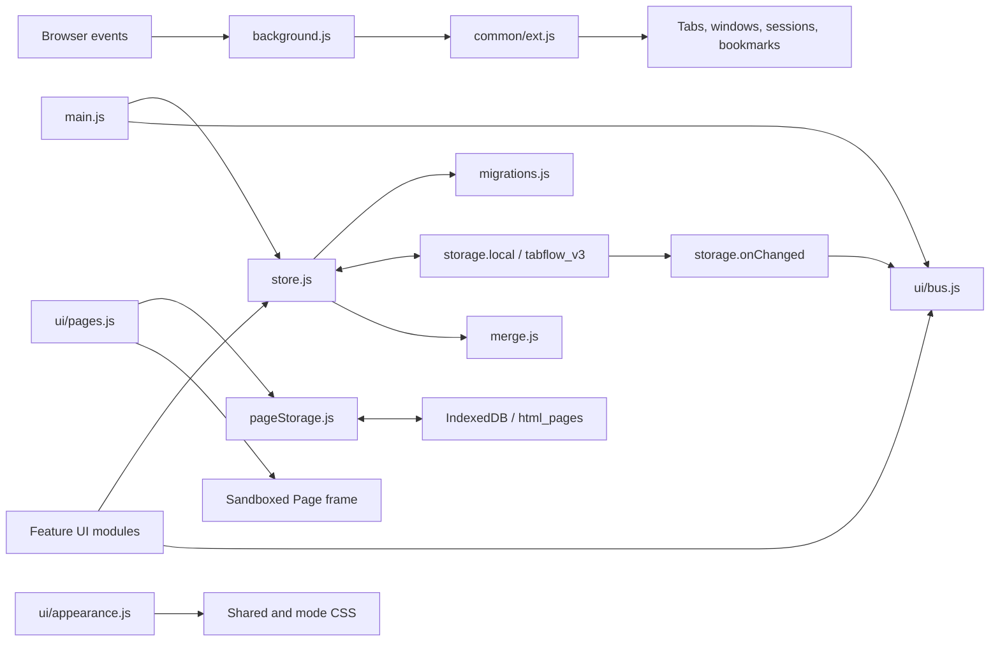

# TabFlow architecture

This is developer documentation. For product behavior, see the [user guide](user-guide.md); for browser setup and distribution, see [installation](installation.md).

TabFlow is a Manifest V3 extension made from native ES modules, DOM builders, and modular CSS. There is no frontend framework, runtime package dependency, cloud backend, or application bundler. Browser-specific behavior is isolated behind the platform layer and packaging.

## Module map

```text
src/
  manifest.json               Chromium source manifest
  background.js               New-tab lifecycle, toolbar, hotkeys, omnibox
  icons/
    tabflow.svg               Canonical Flowfold identity
    icon{16,32,48,128,256}.png Generated raster assets
  common/
    ext.js                    API adapter, capabilities, URL classification, dev shim
    util.js                   DOM helpers, URLs, favicons, IDs, timing, text
    icons.js                  UI icon constants
    themes.js                 Theme tokens, accents, system fonts, editor slots
  newtab/
    newtab.html               Accessible shell, view roots, static dialogs
    newtab.css                Ordered style imports
    styles/
      base.css                Tokens, reset, original shell primitives
      components.css          Collections, cards, live tabs, links, tasks
      settings.css            Settings controls and theme editor
      overlays.css            Menus, dialogs, toast, command palette
      pages.css               Page grid, editor, viewer
      utilities.css           Density, patterns, optional effects, Zen
      physics.css             Temporary drag layers
      workspace.css           Shared workspace composition and components
      modes/normal.css        Editorial collection rows
      modes/tonal.css         Top navigation and tiled collection board
      modes/aurora.css        Floating shell, atmosphere, optical depth
      responsive.css          Viewport-specific composition
      accessibility.css       Focus, motion, transparency, contrast fallbacks
    main.js                   Initialization and cross-window render subscriptions
    store.js                  Live document, queued persistence, snapshots, reset
    merge.js                  Three-way merge for independent window edits
    migrations.js             Defaults, schema 3 normalization, legacy import/export
    pageStorage.js            IndexedDB payloads and portable Page hydration
    pageViewer.js             Shared sandbox mounting for both viewer surfaces
    sandbox.html / sandbox.js Chromium isolated document renderer
    page-host.html / .js / .css Standalone Page wrapper with an opaque iframe
    ui/
      bus.js                  Named render registry
      layout.js               Navigation, panels, shell state, clock, global keys
      appearance.js           Theme/settings to tokens, classes, design identity
      design.js               Mode composition and adaptive enhancement policy
      spaces.js               Collection Spaces and Page Spaces
      collections.js          Saved tabs, search, collection actions, delegated DnD
      opentabs.js              Browser tabs, session/window capture, recently closed
      pages.js                Page editing, storage coordination, sandbox viewer
      links.js / tasks.js     Aliases and task queue
      settings.js             Preference controls, imports, backups, snapshots
      palette.js              Local command index and keyboard launcher
      liquid.js               Optional Aurora pointer/drag enhancements
      dnd.js                  Shared drag payload
      modals.js               Overlay lifecycle and confirmation/prompt dialogs
      contextmenu.js          Declarative contextual actions
      inline.js               Inline rename lifecycle
      toast.js                Transient messages and single-slot Undo
scripts/
  package.ps1                 Browser manifests and zip archives
  generate-icons.mjs          SVG-to-PNG generation (development-only Sharp)
  preview.mjs                 Local HTTP preview with the development adapter
tests/                        Node regressions, UI and real-extension checks
```

The Page viewer's document is isolated from the extension shell. Keep any viewer wrappers or sandbox helpers in this boundary; do not insert imported HTML into an extension-owned DOM container.

## Runtime flow



Boot loads and normalizes state, initializes feature modules, registers their renderers, then renders the workspace. The initial view is Collections. Background activation messages ask the page to focus its launcher when a new-tab duplicate is reused.

Features mutate through `update(fn)` and request only the render regions they changed. Full render passes happen at boot, import/restore, and accepted external changes. Rendering is direct DOM replacement within feature roots; there is no virtual DOM.

## Browser adapter and packaging

`common/ext.js` selects a usable `browser` or `chrome` API by checking `runtime.getURL`, not merely the presence of a global named `chrome`. Both paths expose the promise-style calls used by the app.

API capabilities (`tabGroups`, `sessions`, `bookmarks`, and `localFavicons`) control feature availability. Browser-origin checks distinguish Chromium from Firefox for manifest-related behavior and setup guidance. The Edge user-agent check is limited to the correct extension-shortcut URL; it is not the feature-detection strategy.

| Target | Background | New-tab mechanism | Favicon permission |
| --- | --- | --- | --- |
| Source / Chromium package | `service_worker: background.js`, module | Event-driven recognized-URL redirect | Kept |
| Firefox / Zen package | `scripts: [background.js]`, module event page | `chrome_url_overrides.newtab` | Removed |

The source manifest is not an identical four-browser development manifest. `package.ps1` removes foreign keys and generates the appropriate target. Zip entries use forward slashes and manifests use UTF-8 without a BOM. The script rebuilds its generated `dist/` directory.

### New-tab lifecycle

The background recognizes explicit browser new-tab surfaces and the exact TabFlow workspace page. It redirects only on Chromium. Deduplication is scoped to a window and serialized so overlapping tab events do not independently delete each other's chosen keeper.

The workspace classifier must distinguish `newtab/newtab.html` from other pages belonging to the same extension. Matching the whole extension origin would also close standalone Page viewers. Transient empty URLs, `about:blank`, and `about:home` must not be treated as proof that an unrelated tab is a new-tab request.

The toolbar uses focus-or-open across windows. Hotkey commands read saved tabs from `tabflow_v3` and prefer an exact URL, then an approximate same-site match. Omnibox aliases read Links, provide prefix suggestions, and navigate the active tab. These event handlers are wakeup-driven; no keep-alive loop is required.

## State schema and compatibility

The current storage key remains `tabflow_v3`; the design redesign does not introduce a schema-version bump.

```js
{
  schemaVersion: 3,
  meta: { rev, writer, savedAt },
  spaces: [{
    id, name, color?, icon?, viewMode,
    collections: [{
      id, name, color?, collapsed, sortMode,
      tabs: [{ id, title, url, favicon?, pinned?, note?, tags?, hotkeySlot? }]
    }]
  }],
  activeSpaceId,
  pageSpaces: [{
    id, name, color?, icon?,
    pages: [{
      id, title, method, content, createdAt, updatedAt, tags,
      contentStorage?, contentKey?
    }]
  }],
  activePageSpaceId,
  links: [{ id, name, url }],
  tasks: [{ id, title, url?, done }],
  settings: { /* DEFAULT_SETTINGS in migrations.js */ },
  ui: { sidebarOpen, rightPanelOpen, zenHintDismissed }
}
```

Pages use `method: 'code' | 'upload' | 'embed'`. Collection Spaces and Page Spaces have separate active IDs and collections of children. Do not infer that similarly named Spaces are related.

`normalizeDoc()` accepts existing schema-3 data, fills missing Page Spaces and settings, resolves active IDs, checks known settings, clamps numeric controls, and normalizes external URLs. It is a boundary for persisted structures, not a general HTML sanitizer.

The legacy key `tabflow_v2` represents the older application format. Migration maps per-space views, old `nextItems` to Tasks, old hotkey slots, and supported appearance settings. The source record stays intact during ordinary migration. `parseImport()` accepts the current export envelope, raw schema-3 documents, and supported older shapes. Preserve these formats when extending the model.

### Persistence and concurrent windows

`update(fn)` mutates the live document, marks it dirty, and schedules a write after 300 ms. `flush()` returns the queued persistence result; callers that promise a saved backup or replacement must await it and handle failure.

Each commit reads the latest stored document and performs a three-way merge using the instance's base, its local changes, and remote state. Identified arrays merge by ID. Independent fields/additions can survive concurrent edits; deletion wins over an edit to an item removed on either side, while a direct same-field conflict prefers the committing local value. Local reordering takes priority when changed.

Where available, Web Locks serialize commits for the extension origin. Without that API, the merge still runs but the read-modify-write sequence is not atomic. This is not a CRDT, database transaction across windows, or collaborative-editing guarantee. Full import/reset is intentionally a document replacement, not a merge.

`storage.onChanged` adopts another writer's document when the current instance is not dirty or writing and triggers render listeners. Metadata records a revision, writer ID, and timestamp. A read failure at boot is surfaced rather than followed by a destructive defaults write; save failures leave unsaved changes in memory.

### Pages and IndexedDB

`pageStorage.js` owns database `tabflow_pages_db`, version 1, object store `html_pages`.

- Up to **256 KiB** of UTF-8 content stays inline. Larger payloads are written to IndexedDB before their metadata is updated.
- A large Page has an empty inline body, `contentStorage: 'indexeddb'`, and a `contentKey`. New content uses a new key so a failed metadata commit cannot invalidate the previously saved version.
- Inline content is authoritative when present. An old IndexedDB copy must not override imported or restored HTML with the same Page ID.
- IndexedDB operations resolve on transaction completion and close the database connection. Request success alone does not prove a write committed.
- `hydratePageSpaces()` creates a self-contained copy for export/snapshots, resolving referenced payloads and removing storage-location fields. Missing required payloads fail the operation rather than silently producing an incomplete backup.
- `preparePageSpaces()` prepares imported/restored large content for local storage again.

This is size-based payload separation, not unlimited storage or automatic recovery from every quota error. Main JSON, snapshot history, and IndexedDB remain subject to browser/profile limits.

### Backups and snapshots

The JSON export envelope contains `app`, `schemaVersion`, `exportedAt`, and the portable document. The UI must hydrate Page bodies before building the export. Live browser sessions, snapshot history, browser shortcut remappings, and viewer form state are outside that envelope.

`tabflow_snapshots` is separate from the main document. New snapshots include collection Spaces and hydrated Page Spaces; up to 20 are retained. Restore keeps current settings, Links, and Tasks. For old snapshots without `pageSpaces`, preserve the current Pages. Because snapshots include content, they consume local storage too.

Clear All commits a starter document before purging Page payloads, snapshot history, legacy records, and historical Page-form keys. A failed metadata write leaves the previous saved payloads intact. Reset Settings only resets the settings object while retaining custom-theme definitions and workspace content.

Page bodies use versioned keys so a failed metadata commit cannot corrupt the last saved document. Unreferenced versions are retained until Clear All; reference-aware garbage collection is a follow-up. Individual Page deletion removes workspace metadata, without racing another window's payload reads.

## Design architecture

Three concerns stay separate:

1. **Theme:** `themes.js` supplies colors; custom themes provide compatible CSS properties.
2. **Preferences:** `appearance.js` applies accent, system font, density, size, backgrounds, and effects.
3. **Composition:** `body[data-design]` and the mode modules select the visual system and layout.

Existing `liquidGlass` and `materialYou` storage flags remain the compatibility source for Aurora and Tonal. Both false selects Normal; the modes are mutually exclusive. Legacy body classes and stable feature selectors remain available where practical for existing custom CSS.

`ui/design.js` maps those persisted flags to `body[data-design]`, moves shared navigation for Tonal, updates the overview metrics, and applies the effect budget. The budget combines workspace size, reduced-motion/transparency/contrast/forced-color preferences, page visibility, and coarse device capability signals; it adds `effects-static` or `effects-opaque` fallbacks without disabling the underlying feature.

| Mode | Structural treatment |
| --- | --- |
| Normal | Collections form horizontal editorial bands: a compact identity/action column beside the saved-card area. Navigation remains a conventional sidebar. |
| Tonal | Primary view navigation moves above the canvas, the sidebar emphasizes Spaces, and Collections tile into a rounded multi-column board. Larger typography and pill controls reinforce the composition. |
| Aurora | A detached shell frames an atmospheric workspace. A larger overview, floating Collection containers, optical card layers, illuminated edges, and interaction depth create a spatial composition. |

Changing mode must preserve document data, active view, card-view preference, and working feature hooks. Mode-specific navigation should move shared controls rather than duplicate competing event handlers. Settings, Pages, dialogs, menus, and live tabs must inherit the mode language too.

The stylesheet entry point orders shared modules, workspace composition, mode styles, responsive adjustments, then accessibility. Custom CSS is appended afterwards. Keep future mode rules in their owning file rather than growing a second catch-all override block.

### Aurora rendering budget

The atmospheric layers sit outside the scrolling feature DOM. Normal cards use optical gradients and solid-backed surfaces rather than one backdrop blur per card. Live blur is restricted to a small number of chrome surfaces and transient interactions. Avoid viewport-sized SVG blur/goo filters.

Pointer work is delegated and animation-frame-bounded; update only the active target. Drag effects are temporary and must stop on drop, dragend, cancellation, lost focus, or visibility changes. Low-capability and large-item fallbacks reduce enhancement without changing feature behavior.

Motion and transparency preferences affect JavaScript as well as CSS. No animated ghost should remain running simply because CSS made it invisible. Prefer transforms and opacity for movement, limit geometry reads, and clean up inline transforms when the mode changes.

## Accessibility boundaries

Shared controls need visible focus, accessible names, sensible hit areas, and a logical DOM focus order in each composition. Keyboard-only access must not depend on hover. Dialogs and the command palette need contained focus and return focus on dismissal. Context menus need keyboard navigation.

Reduced motion suppresses transitions, animation, pointer tilt, and drag physics. Reduced transparency, increased contrast, and forced-color modes use readable solid surfaces and focus boundaries. Test each preference independently and in combination with light themes and custom themes. User CSS may override the supplied safeguards; do not represent arbitrary custom CSS as contrast-validated.

Drag-and-drop is a pointer interaction over the shared payload `card | collection | open-tab`. Cards use delegated dragover/drop handling on the Collection area; Spaces and Tasks use their own custom MIME payloads. Keep non-drag actions available for capture, opening, and moving Collections.

## Security and privacy boundaries

The extension shell loads bundled scripts under its extension-page CSP. User titles, URLs, notes, tags, and names use text nodes; the DOM helper's `html` option is only for trusted constants.

Page HTML is intentionally active user content and belongs in a sandboxed frame without `allow-same-origin`. Do not weaken that boundary to access viewer form state. Browser CSP still applies, so do not promise identical script execution across engines. Embedded websites can enforce their own framing restrictions.

Chromium mounts the manifest-declared `sandbox.html`, then passes HTML from the parent to `sandbox.js`. The renderer accepts one message from its parent and writes into its own opaque document under the sandbox CSP. Inline scripts were verified in Edge without extension APIs. Firefox/Zen use a sandboxed `srcdoc` with the extension CSP; inline scripts may be blocked. The package removes Chromium-only sandbox manifest keys. Both embedded and standalone HTML viewers share `pageViewer.js`; `page-host.html` retrieves the saved Page by ID and retains the iframe boundary.

Any message from a viewer must verify its source and validate the requested action/HTTP(S) URL before calling an extension API. A Page opened in a new browser tab must retain its sandbox wrapper rather than receive an unsandboxed extension-origin blob document.

Saved favicon URLs may be remote. The Google fallback is separately controlled by `remoteFavicons`, enabled by default. Page resources, embeds, external navigation, and user CSS may request network resources. The app has no analytics or sync server; “local-first” does not mean all displayed content is network-isolated.

## Development and verification

For a quick UI preview, serve `src/` over HTTP and open `/newtab/newtab.html`. For example, with an existing Python installation:

```powershell
python -m http.server 4173 --directory src
```

The development shim uses localStorage and demo tabs when no extension API is present. It is useful for layout and ordinary UI flows, but **does not establish correctness of extension CSP, new-tab handling, shortcut commands, sessions, bookmarks, or real browser storage events**. Use a disposable browser profile for extension tests.

A meaningful release pass covers:

| Area | Verify |
| --- | --- |
| Loading / packaging | Both manifests parse; every referenced asset/module is present; extension and background consoles remain clear |
| Browser lifecycle | New tab, rapid duplicate creation, new window, toolbar activation, unrelated blank/extension tabs, separate Page viewers |
| Persistence | Existing schema-3 data, legacy migration, independent edits in two windows, same-field conflicts, failed storage reads/writes |
| Core flows | All card views, search, card/Collection/Space drag-and-drop, session capture, recently closed, Links, Tasks, hotkey assignment |
| Pages | Upload/code/embed, Page Spaces, large IndexedDB payload, edit/reopen, external viewer, export/import with matching IDs, old/new snapshots |
| Design | Switch all three modes without reload; light/dark/custom themes; 100+ cards; visible keyboard focus; narrow laptop and ultrawide layouts |
| Accessibility | Keyboard dialogs/palette/menus; reduced motion; reduced transparency; increased contrast; forced colors |
| Data actions | Bookmark import, JSON backup, settings reset, full reset, accurate error reporting, no silent content loss |

Keep automated regression tests focused on state transitions and browser contracts. Record actual browser/version and results when running the matrix; this checklist is not a claim that every browser has passed.

See [testing and verified scope](testing.md) for executable checks, observed results, and the remaining browser release checks.

### Extending the product

- Add a setting to `DEFAULT_SETTINGS`, normalize it, wire its control in `settings.js`, and apply its effect in the owning module. Preserve existing defaults on migration.
- Add a feature renderer to `bus.js` through `registerRenderer()`; mutate with `update()` and render the relevant regions.
- Add theme tokens in `themes.js`; keep mode geometry out of theme presets.
- Keep the SVG logo canonical and regenerate PNG sizes with `scripts/generate-icons.mjs`. Sharp is a development dependency only; no image-generation library ships in the extension.
- Add a storage migration only when the data shape requires one. Test both older exports and in-place data before changing schema or payload location.
