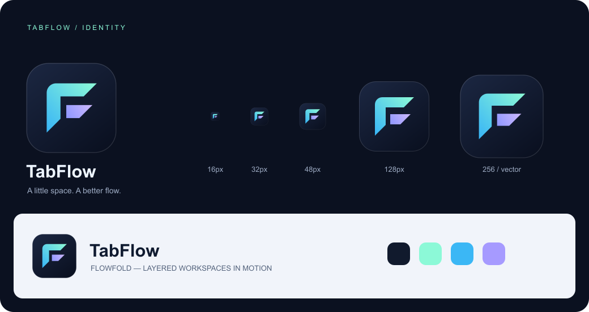

# TabFlow identity

**Flowfold** turns two forward-cut tab planes into an open **F**. The continuous
cyan stroke suggests a path from browsing into an organized workspace; the
separated violet plane represents a second layer of work. The open spaces and
wide strokes remain legible at toolbar sizes. There is no globe, browser ring,
fine outline, or detail that depends on a large canvas.

The final direction was selected from three concepts: an orbital navigation
symbol, overlapping window outlines, and the folded-tab monogram. The first two
were too close to common browser and tab-manager symbols. Flowfold gives TabFlow
its own compact silhouette without relying on the wordmark.

- **Canonical artwork:** [`src/icons/tabflow.svg`](../src/icons/tabflow.svg).
- **Toolbar and extension PNGs:** 16, 32, 48, 128, and 256 pixels.
- **Palette:** deep ink `#111A2D`, mint `#8CF9D7`, sky `#3BB7F5`, and violet `#A69AFF`.
- **Surfaces:** the ink tile gives the mark consistent contrast on light and dark
  browser chrome. Keep its proportions and transparent outer corners intact.
- **Wordmark:** use the product's system font in a medium or bold weight. Keep
  the name as “TabFlow”; do not bake small text into an extension icon.
- **Clear space:** allow at least one quarter of the tile width around standalone
  artwork. In compact controls, use the tile itself without a second container.

All paths are original. The SVG contains no external assets, fonts, scripts, or
filters. The same artwork powers the UI, favicon, extension toolbar, and product
documentation.

To regenerate PNGs and this identity board, install the development-only renderer
with `npm install --no-save sharp`, then run `node scripts/generate-icons.mjs`.
An existing Sharp installation can instead be supplied through `NODE_PATH`.
The packaged extension has no rendering or build-time dependency.
